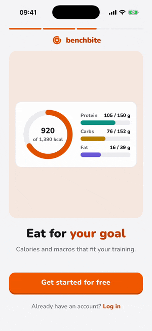
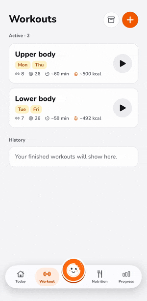
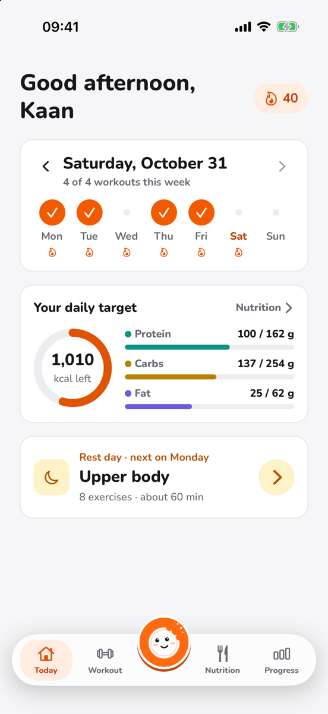
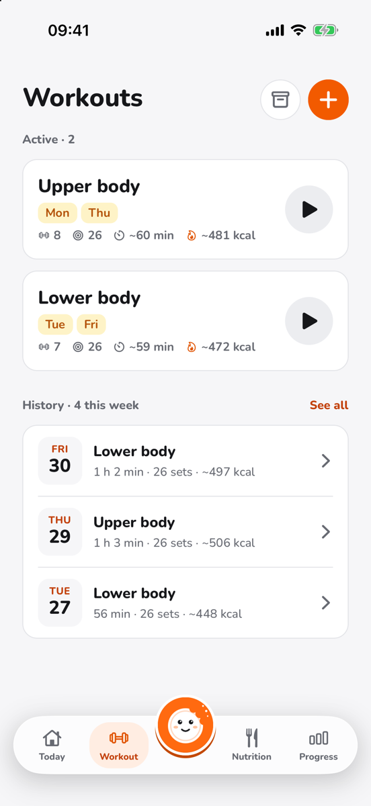
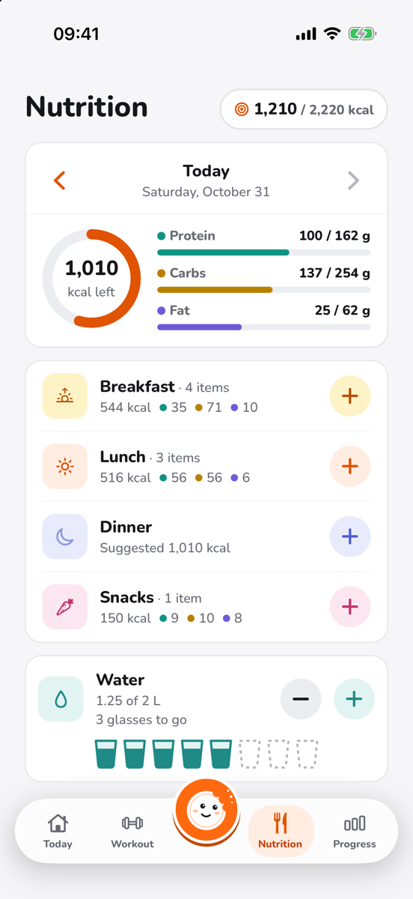
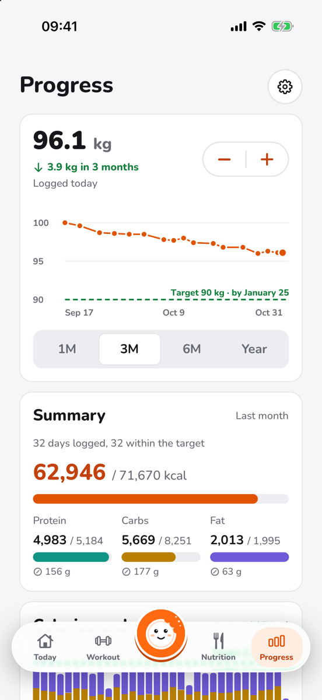
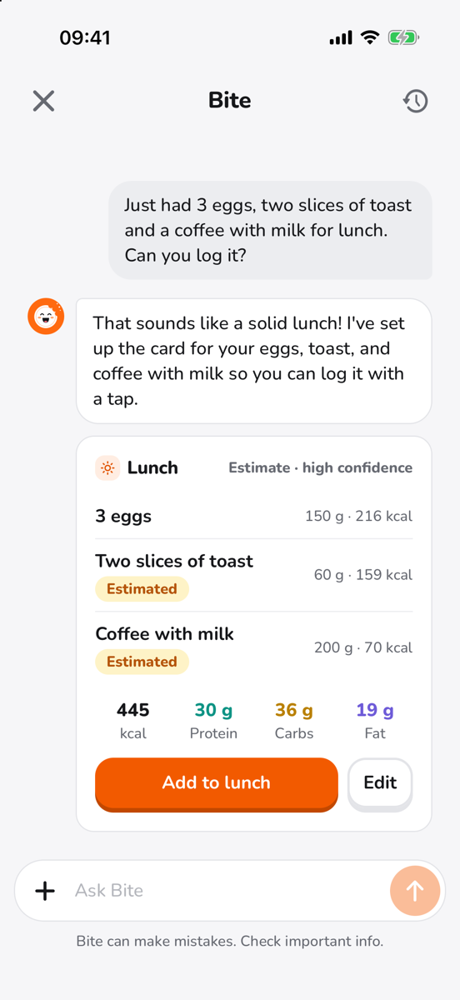
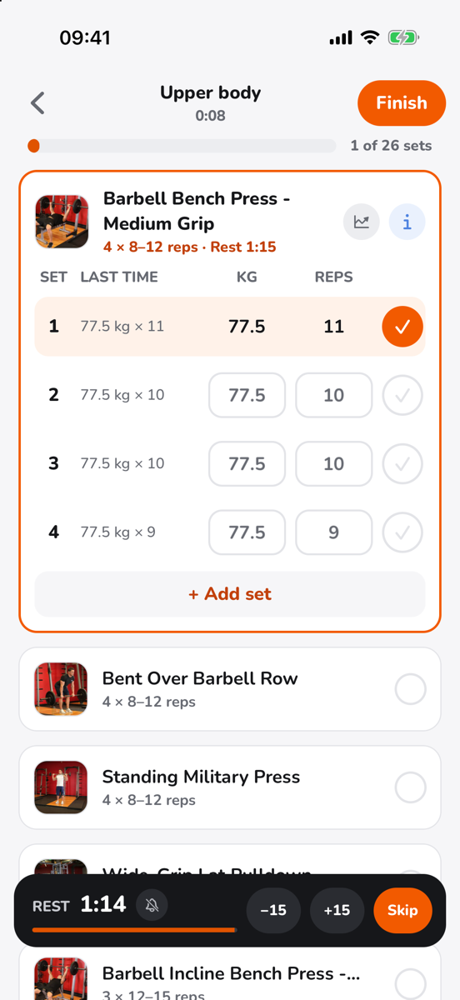
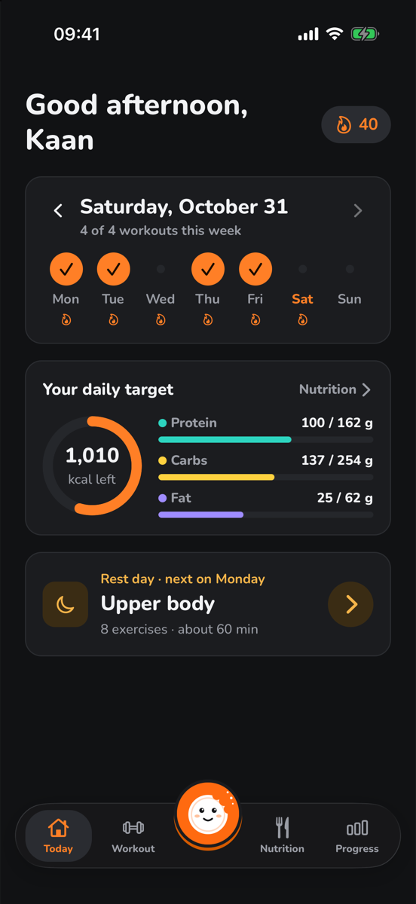
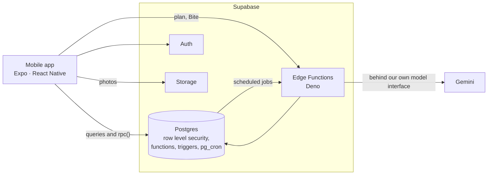

<h1 align="center">Benchbite</h1>

<p align="center">
  Workouts and nutrition in one app, with a plan built around you and a coach to talk to.
</p>

<p align="center">
  <a href="https://github.com/Kaandroids/benchbite/actions/workflows/ci.yml"></a>
  
  
  
  <a href="LICENSE"></a>
</p>

<table align="center">
  <tr>
    <td></td>
    <td></td>
  </tr>
  <tr>
    <td align="center">The onboarding</td>
    <td align="center">Making a workout</td>
  </tr>
</table>

> **Status:** in development, with no release yet. Workouts, nutrition, progress and the AI
> coach work end to end; see the [roadmap](#roadmap).

## Highlights

- **A plan from a few questions.** The onboarding asks for the goal, body data and training
  preferences, then sets daily calorie and macro targets and builds a weekly workout plan that
  fits the chosen workout length. No account needed: people start as guests and sign up later.
- **Workouts that remember.** About 870 exercises with pictures, last time's sets beside each set,
  a rest timer that notifies in the background, records and progress charts per exercise, and
  alternatives of a workout for days with other gear.
- **Nutrition without the busywork.** A food library of the German BLS 4.0 in English, German and
  Turkish, recipes and foods of one's own, frequent and favourite foods, water, and targets that
  follow the weight.
- **Bite, the coach.** A chat that knows the plan, the meals and the workouts. Describe a meal or
  send a photo of it and Bite turns it into a card to add with a tap; it proposes changes to
  workouts, targets and the food log, and the user decides.
- **Progress and streaks.** Weight over time, monthly summaries, and a daily streak with freezes
  for the days life gets in the way.
- **Made to be used every day.** English, German and Turkish, light and dark mode, and reminders
  planned from the week.

## Screenshots

<table>
  <tr>
    <td></td>
    <td></td>
    <td></td>
    <td></td>
  </tr>
  <tr>
    <td align="center">Today</td>
    <td align="center">Workouts</td>
    <td align="center">Nutrition</td>
    <td align="center">Progress</td>
  </tr>
  <tr>
    <td></td>
    <td></td>
    <td></td>
    <td></td>
  </tr>
  <tr>
    <td align="center">Bite makes a meal card</td>
    <td align="center">During a workout</td>
    <td align="center">Dark mode</td>
    <td></td>
  </tr>
</table>

The screenshots show a demo account made with `pnpm seed:demo`; [docs/media](docs/media/README.md)
says how to take them again.

## Architecture

There is no separate backend server. The app talks to Supabase directly, row level security
decides what each user may read and write, and anything atomic or multi-table runs in Postgres
functions ([ADR 0001](docs/adr/0001-react-native-and-supabase.md)).



| Layer             | Technology                                                                |
| ----------------- | ------------------------------------------------------------------------- |
| Mobile            | React Native with Expo, Expo Router, TanStack Query, i18next              |
| Backend           | Supabase: Postgres with row level security, Auth, Storage, Edge Functions |
| Server-side logic | Postgres functions, triggers and pg_cron; Edge Functions in Deno          |
| AI                | Gemini, behind an interface of our own                                    |
| Tests             | Jest and React Native Testing Library, pgTAP, Deno test                   |

## How it is built

- **Decisions are written down.** Every significant choice is an
  [Architecture Decision Record](docs/adr/README.md), from the stack to how Bite's photos are
  purged: 68 so far.
- **AI-assisted, reviewed by a person.** Work is planned with
  [Claude Code](https://claude.com/claude-code), implemented in pull requests by the
  `benchbite-bot` GitHub App, reviewed automatically for design, security, and logic and
  performance with the [review skills](.claude/skills/), and merged by the maintainer.
  [CONTRIBUTING.md](CONTRIBUTING.md) describes the flow.
- **Checked on every pull request.** CI runs types, lint, formatting, the app's tests,
  translations and the Edge Functions' checks, and on a local Supabase stack the database tests,
  the generated types and every plan the plan builder can make.
- **Security first.** Row level security on every table, schema changes only through migrations,
  only the publishable key in the app, and photo metadata stripped on the device.

## Getting started

```bash
git clone https://github.com/Kaandroids/benchbite.git
cd benchbite
corepack enable
pnpm install
cp .env.example .env.local
pnpm supabase start   # needs Docker
pnpm start
```

[Development](docs/development.md) covers the prerequisites, the local Supabase stack, the
Edge Functions and the scripts; [Deployment](docs/deployment.md) covers the hosted project,
its monitoring and installing a release build on an iPhone.

## Roadmap

Planned work is tracked in [milestones](https://github.com/Kaandroids/benchbite/milestones) and
[issues](https://github.com/Kaandroids/benchbite/issues). Before the first release come a privacy
policy and terms of use, build profiles and a staging project, and hardening storage, auth and the
supply chain ([Release](https://github.com/Kaandroids/benchbite/milestone/12)).

## Documentation

- [Development](docs/development.md): running the app and the backend locally
- [Deployment](docs/deployment.md): the hosted project, its monitoring and installing on an iPhone
- [Architecture Decision Records](docs/adr/README.md): why the app is built the way it is
- [CLAUDE.md](CLAUDE.md): the conventions every change follows
- [CONTRIBUTING.md](CONTRIBUTING.md): how changes get into the project

## Acknowledgements

The exercise data and images come from [free-exercise-db](https://github.com/yuhonas/free-exercise-db)
by Clint Plummer ([@yuhonas](https://github.com/yuhonas)) and contributors, released into the
public domain under the [Unlicense](https://github.com/yuhonas/free-exercise-db/blob/main/LICENSE.md).

The food data comes from the [Bundeslebensmittelschlüssel (BLS) 4.0](https://blsdb.de) by the
Max Rubner-Institut, Karlsruhe, released under
[CC BY 4.0](https://creativecommons.org/licenses/by/4.0/). The names in Turkish, some shortened
names and the portion sizes are our own.

## License

[MIT](LICENSE)
