# Benchbite

A mobile app for tracking workouts and nutrition in one place.

> **Status:** In development. Onboarding, workout tracking and email accounts work end to end;
> nutrition tracking comes next. There is no release yet. See the [roadmap](#roadmap).

## Screenshots

**Onboarding:** a few questions in three sections, then a plan built from the answers.

<table>
  <tr>
    <td>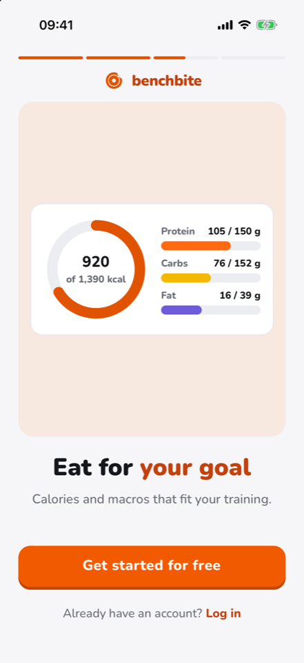</td>
    <td>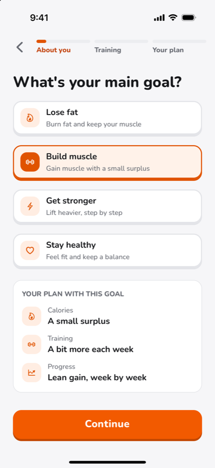</td>
    <td>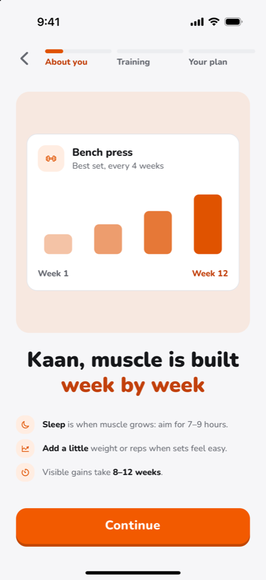</td>
  </tr>
  <tr>
    <td>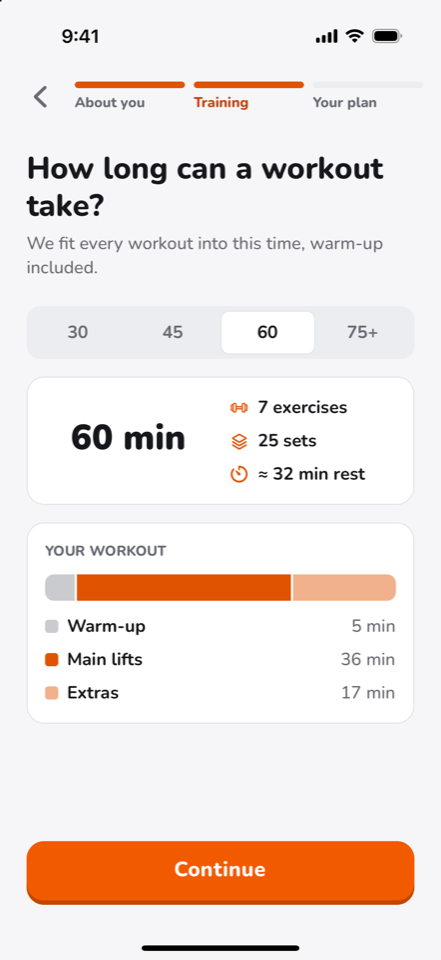</td>
    <td>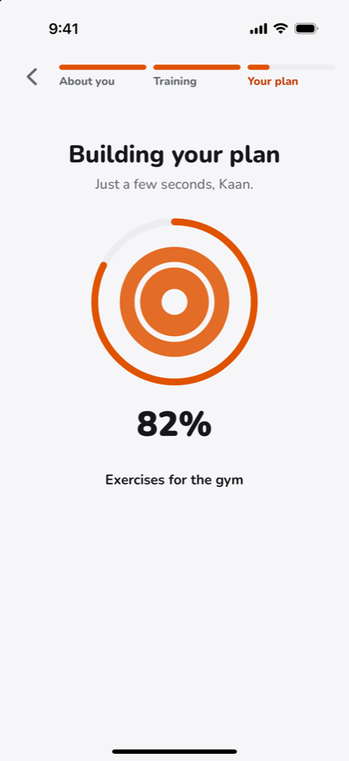</td>
    <td>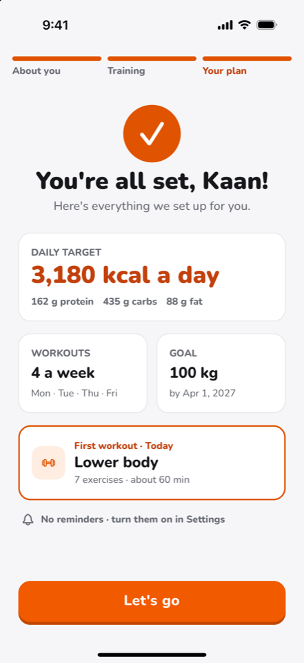</td>
  </tr>
</table>

**The app:** the week at a glance, workouts to start, sets to log, and records over time.

<table>
  <tr>
    <td>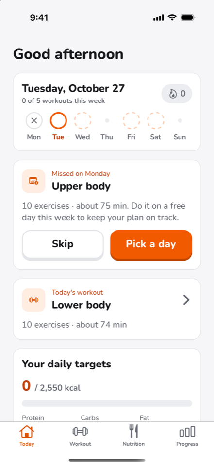</td>
    <td>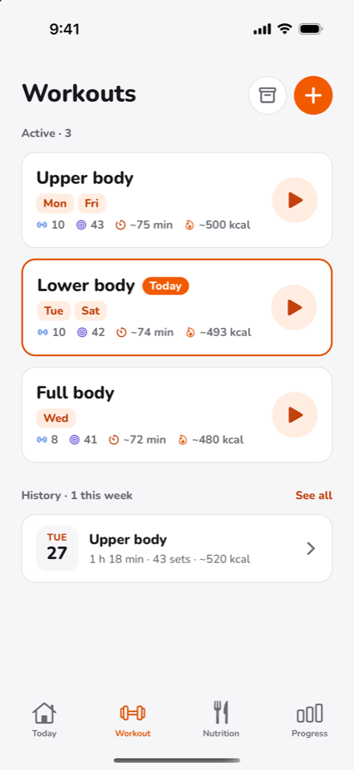</td>
    <td>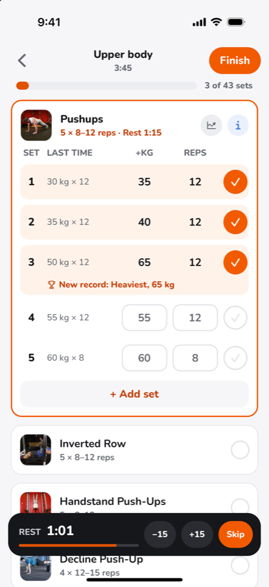</td>
  </tr>
  <tr>
    <td>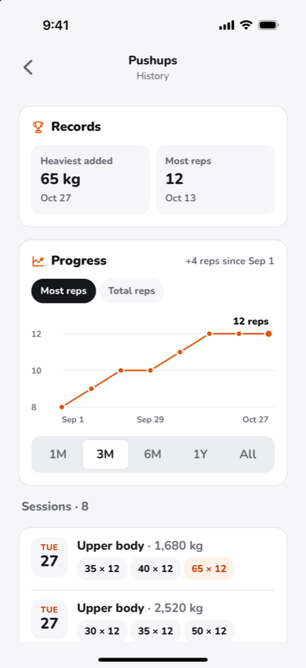</td>
    <td>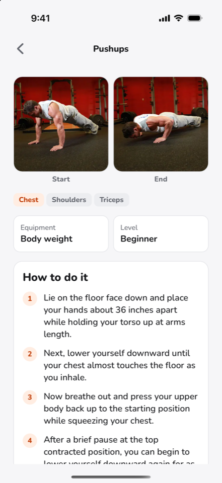</td>
    <td></td>
  </tr>
</table>

## Features

- **Start without an account.** People use the app as a guest; the session lives on the device
  ([ADR 0005](docs/adr/0005-guest-first-accounts.md)). A guest can create an account with an
  email address and a password at any time, keeping everything logged so far, and log in on
  another device ([ADR 0031](docs/adr/0031-email-and-password-accounts.md)).
- **Onboarding** asks for the goal, body data and training preferences in three sections, then
  calculates daily calorie and macro targets and builds a weekly workout plan that fits the
  chosen workout length ([ADR 0009](docs/adr/0009-nutrition-targets.md),
  [ADR 0010](docs/adr/0010-plan-builder-edge-function.md)).
- **Today** shows the week's workouts, today's workout or the next one, the daily targets and the
  weight.
- **Workouts** can be edited, reordered, archived and created from scratch, from a library of
  about 870 exercises or the user's own exercises with private photos.
- **Logging a workout:** sets with weight, reps, time or distance, a rest timer that notifies in
  the background, and a summary with estimated calories at the end. A workout left open is saved
  on its own after 12 hours.
- **History and records:** every finished workout by week, editable afterwards, and per exercise
  its progress chart and records such as the heaviest set and the estimated one-rep max.
- **Settings:** English, German and Turkish, and a light, dark or system appearance.

## Roadmap

Planned work is tracked in [issues](https://github.com/Kaandroids/benchbite/issues) and
[milestones](https://github.com/Kaandroids/benchbite/milestones).

What already works is under [Features](#features); finished work is in the
[closed issues](https://github.com/Kaandroids/benchbite/issues?q=is%3Aissue+is%3Aclosed).

**Next**

- [ ] Nutrition tracking: logging meals against the daily targets, with a food database
- [ ] The Progress tab: weight over time ([#65](https://github.com/Kaandroids/benchbite/issues/65)),
      daily streaks and freezes ([#70](https://github.com/Kaandroids/benchbite/issues/70)), and
      earlier weeks ([#71](https://github.com/Kaandroids/benchbite/issues/71))
- [ ] More ways to sign in: Apple ([#132](https://github.com/Kaandroids/benchbite/issues/132)),
      Google ([#133](https://github.com/Kaandroids/benchbite/issues/133)), confirming email
      addresses and resetting passwords ([#173](https://github.com/Kaandroids/benchbite/issues/173)),
      and deleting an account ([#134](https://github.com/Kaandroids/benchbite/issues/134))

**Before the first release**

- [ ] Privacy policy ([#44](https://github.com/Kaandroids/benchbite/issues/44)) and terms of use
      ([#48](https://github.com/Kaandroids/benchbite/issues/48))
- [ ] Build profiles, a staging project and versioned releases
      ([#165](https://github.com/Kaandroids/benchbite/issues/165),
      [#166](https://github.com/Kaandroids/benchbite/issues/166),
      [#167](https://github.com/Kaandroids/benchbite/issues/167))
- [ ] Hardening storage, auth settings and the supply chain
      ([#56](https://github.com/Kaandroids/benchbite/issues/56))

**Later**

- [ ] Personal plans from an AI coach ([#38](https://github.com/Kaandroids/benchbite/issues/38))
- [ ] Supersets ([#141](https://github.com/Kaandroids/benchbite/issues/141)) and heart rate from
      Apple Health and Health Connect ([#85](https://github.com/Kaandroids/benchbite/issues/85))
- [ ] Logging workouts and meals offline ([#6](https://github.com/Kaandroids/benchbite/issues/6))

## Tech stack

| Layer             | Technology                                                                |
| ----------------- | ------------------------------------------------------------------------- |
| Mobile            | React Native with Expo, Expo Router, TanStack Query, i18next              |
| Backend           | Supabase: Postgres with row level security, Auth, Storage, Edge Functions |
| Server-side logic | Postgres functions and triggers; Edge Functions in Deno and TypeScript    |
| Tests             | Jest and React Native Testing Library, pgTAP, Deno test                   |

There is no separate backend server: the app talks to Supabase directly, row level security
decides what each user may read and write, and anything atomic or multi-table runs in Postgres
functions ([ADR 0001](docs/adr/0001-react-native-and-supabase.md)).

## Getting started

See [Development](docs/development.md) to run the app with a local Supabase stack, and
[Deployment](docs/deployment.md) for the hosted project, monitoring and installing on an iPhone.

## Development workflow

This project uses an AI-assisted workflow. Features are planned together with
[Claude Code](https://claude.com/claude-code), implemented by the `benchbite-bot` GitHub App
in pull requests, and reviewed and merged by the maintainer. Each pull request Claude opens is
first reviewed automatically for design, security, and logic and performance, with the skills in
[`.claude/skills/`](.claude/skills/).

## Documentation

- [Development](docs/development.md): running the app and the backend locally
- [Deployment](docs/deployment.md): the hosted project, its monitoring and installing on an iPhone
- [Architecture Decision Records](docs/adr/README.md): why the app is built the way it is
- [CLAUDE.md](CLAUDE.md): the conventions every change follows
- [CONTRIBUTING.md](CONTRIBUTING.md): how changes get into the project

## Acknowledgements

The exercise data and images come from [free-exercise-db](https://github.com/yuhonas/free-exercise-db)
by Clint Plummer ([@yuhonas](https://github.com/yuhonas)) and contributors, released into the
public domain under the [Unlicense](https://github.com/yuhonas/free-exercise-db/blob/main/LICENSE.md).

The food data comes from the [Bundeslebensmittelschlüssel (BLS) 4.0](https://blsdb.de) by the
Max Rubner-Institut, Karlsruhe, released under
[CC BY 4.0](https://creativecommons.org/licenses/by/4.0/). The names in Turkish, some shortened
names and the portion sizes are our own.

## License

[MIT](LICENSE)
